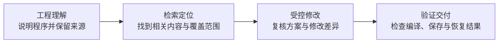

# 产品能力架构

## 面向工程判断的协作方式

PLC 智能工程助手适用于使用 InoProShop 的工程团队。工程负责人可据此组织自主评估，工程师可从工程理解和信息定位开始，逐步验证受控修改与交付过程。

工程师通过配套对话入口提出任务，在既有工程环境中核查结果。助手提供有依据的信息和操作结果，任务范围、工艺判断及交付决策由工程师掌握。

## 四项能力如何协同

图示描述产品能力之间的协作关系。**任务授权、变更复核、过程留痕和条件满足时的异常恢复贯穿流程。** 四项能力也可按任务单独使用，例如只解释程序或只查找文本。

| 产品能力 | 客户提出的任务 | 可核查的交付结果 |
|---|---|---|
| 工程理解 | 理解已有程序的意图、变量和相关逻辑 | 说明、源码位置、已读取范围及待核查内容。 |
| 检索定位 | 找出变量、文本或相关用法 | 可定位的结果及其适用范围；文本命中与已确认关系分别说明。 |
| 受控修改 | 对指定程序进行范围明确的调整，或使用已准备模板创建副本 | 修改方案、变更差异和适用前提；模板对应的控制器须经过复核。 |
| 验证交付 | 核查一处变更是否完成，决定保存、恢复或继续处理 | 修改、编译、保存和恢复分别说明结果；未能确认的部分保留待处理状态。 |

## 工程质量保障

- **范围明确**：先确认目标工程与任务，再对允许范围内的工程副本执行修改。
- **过程可复核**：变更前可查看方案与差异，变更后检查实际结果。
- **结果分项说明**：修改完成、编译通过和保存完成分别判断，便于工程师评审。
- **异常有处理路径**：具备条件时恢复受控变更；遇到后续人工修改或结果无法确认时，保留材料并进行人工核查。

这些保障用于支持工程决策。设备工艺、安全联锁、现场联调及运行确认仍由工程团队完成。

## 评估与交付关系

首次评估先确认环境连接与读取结果，再由部署负责人确认本机修改和编译能力。模板相关任务还需准备与目标设备相符的参考工程。产品不代替模板型号核实，也不会为了完成任务自动更换控制器。

已有工程仍在 InoProShop 中管理，对话入口使用已配置的 ohmypi 与模型服务。交付前应明确可用版本、工程副本位置、模型使用约定和本次可评估的任务。

## 适用边界

当前重点为可读取的 ST 文本工程与已验证的操作范围。未读取、加密或未覆盖的图形内容不能视为已经理解；检索零命中也不能证明整个工程不存在相关用法。

工程处理在本机进行，模型交互涉及所发送的信息。依赖准备可离线完成；选择云模型时仍需网络及相应数据使用约定。[数据与使用说明](PRIVACY.md)。

[开始自主评估](../services/inoproshop-mcp/docs/OFFLINE_README.md) · [返回产品首页](../README.md)
