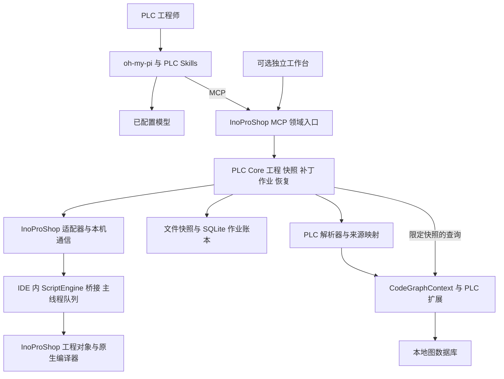

# InoProShop MCP 开发需求与架构规划

版本 1.1 ｜ 更新日期 2026 年 10 月 12 日 ｜ 状态 P0 实施基线，验收状态见固定报告

本文面向 PLC 工程师、MCP 服务开发者与测试人员，汇总本工作区历次 Demo 的操作需求及验证证据，并将其转化为可实施、可验收的 InoProShop MCP 开发方案。选型沿用 **oh-my-pi 作为 Agent、CodeGraphContext 作为代码索引框架、MCP 作为工具接口**。

**建议先交付单台 Windows 工程站上的 ST 工程闭环：读取当前工程 → 查询有来源的上下文 → 预览变更 → 写入和回读 → 原生编译 → 恢复或保存 → 更新索引。** 工程控制、PLC 语义适配和持久化作业是本次主要开发内容。历史 Demo 可复用宿主操作经验，但不能直接视作完整 MCP 产品。

1.0 版只整理需求和历史证据；1.1 版记录已确认的实施范围。新服务位于 `services/inoproshop-mcp`，本轮宿主和协议实测证据单独保存在 `artifacts/mcp_p0`。下文历史报告仍只代表原 Demo；接口实现、原生验收和模型评测分别记账，未通过的必交项不得计为 P0 完成。

## 1 决策摘要

| 项目 | 本版决策 |
|---|---|
| Agent | 固定使用 `can1357/oh-my-pi`，由其负责模型调用、任务规划、工具使用及解释 |
| 工程入口 | 对 Agent 提供统一 InoProShop MCP 服务，显式携带工程、宿主和快照标识 |
| 索引 | 使用 CodeGraphContext，加本项目 PLC 解析、图模型和查询适配；不将 ST 当作 Pascal 直接套用 |
| 宿主操作 | 外部服务通过本机通信调用 IDE 内 ScriptEngine 桥接；宿主对象操作在 IDE 主线程串行执行 |
| 首期范围 | 离线工程副本、ST 读取和修改、诊断、回滚、保存、导出、监测、限定 PLC 关系查询 |
| 图形语言 | 保留已验证 BOOL 子集和 SFC 用例；通用图形读取、修改、等价性验收设置独立能力门槛 |
| 工程版本 | 先适配已验证的 InoProShop 1.10.0.3 / ScriptEngine 3.5.11.10；其他版本逐个验证 |
| 发布标准 | 确定性工具契约与原生工程闭环先通过，再评价模型生成和自动修复效果 |

CodeGraphContext 可以独立作为另一个 MCP 服务接入 OMP，这是协议层可行的接法。本文沿用既有架构 v1 的**统一领域入口**：工程工具和上下文工具共享项目、快照与作业状态，内部复用 CGC。CGC 原生 MCP 保留为开发诊断入口；若后续采用两个公开 MCP，必须通过相同快照契约验收，不能各自默认为“当前工程”。此调整不改变用户已选定的三项技术。[D12] [W01] [W02]

## 2 历史 Demo 操作与证据基线

### 2.1 证据使用规则

“已验证”仅指指定工程、运行编号和软件版本上的实际结果。“部分验证”表示能力只有子集、单侧路径或历史成功记录。“待开发”包含新的产品化要求及没有真实闭环证据的展示功能。“受阻”表示已观察到具体失败。

报告优先级为：带运行编号的原生报告及原始消息 → 对应测试代码 → 汇总报告 → README 或演示讲稿。`latest*.json` 只是索引或可变文件，不能仅靠文件名认定它比所有固定报告更新。不同测试套件数量不相加作为总覆盖率。

### 2.2 分阶段核对结果

| 阶段与证据 | 实际验证内容 | 结论与剩余边界 |
|---|---|---|
| 9 月 4 日 V1 可点击 Demo | 宿主脚本和窗体构建、示例工程打开、68 个节点读取；八页能力展示 | 固定 ST、审查和测试场景是演示内容；不证明真实大模型生成、语义审查或行为测试已完成。见 D01、D02 |
| 9 月 7 日起 V2 核心 | 真正读取声明和实现、关键词检索、差异预览、版本检查、写入、编译、回滚、保存重开 | 最新固定集成运行 `integration_a33439ad0d` 保留图形回读受阻状态；旧 BM25 不等于符号图。见 D03、D04 |
| 9 月 11 日原生交互回归 | 脚本返回后窗体保留、非模态、IDE 启用、主线程回调四项通过 | `activate_ide_from_workbench` 失败；未找到这套完整交互回归随后全部通过的证据。见 D10 |
| 9 月 15 日编译诊断 | 17 组原生用例、14 组拒绝编译、20 条诊断全部映射；三组运行风险通过编译 | 支持错误位置和源码片段；编译通过不证明运行逻辑正确。见 D05 |
| 9 月 15 日诊断界面 | 固定会话 `c43e986cad` 中 13 项通过，未保存错误约 4.829 秒反馈 | 可变 `diagnostics_ui.json` 留有较早的失败，时间早于固定成功报告；不能描述成后续退化，也不能忽略启动异常。见 D10 |
| 9 月 15 日 AI 资料包 | 14 项原生检查通过；读取对象、ST、任务配置和任务调用，包含未保存对象模型变化 | 不含完整图形网络、全部 I/O、通信和库源码；44 项本地测试为当时测试集。见 D06 |
| 9 月 15 日语言兼容性 | C# DLL、独立 C# 进程、VB.NET DLL；16 项通过、1 项原生插件前置条件受阻 | 均依赖既有宿主适配；没有验证纯 C# 原生 IDE 插件或现代 .NET 进程内加载。见 D07 |
| 9 月 18 日 SFC | 9 组原生用例、11 项页面检查、62 项本地测试通过；保存、重开、再编译 | 9 次图形 XML 回读失败；生成的 XML 不能冒充宿主导出的 XML。见 D08 |
| 10 月 10 日真实外部工程 | AM402“未命名1”副本成功打开；66 个节点，编译 2 错误、2 警告 | 错误修正建议未实际写入和复测；说明服务必须处理带既有错误的工程。见 D09 |

上述数字是各自报告中的历史结果，不是本次新跑出的测试成绩。此次证据核对没有重新验证目前仍打开的 IDE 或机器进程状态。

### 2.3 历史提出但尚未完成的目标

原始计划还提出自然语言生成 FB/PRG/FUN、上下文驱动审查、输入序列和期望输出生成、变量表和变更文档、编译错误自动修复、库依赖和 I/O 建议、在线只读监控、Watch 列表、可视化草案、Git/CI 和原生停靠面板。它们均保留在本次需求清单中，但不因曾出现按钮或演示文字而记为已完成。[D02]

## 3 产品目标与成功标准

1. **把已验证宿主能力变成可重复调用的工具。** 支持清单内的读取、预览、写入、回读、编译、保存和恢复均能通过 MCP 完成；错误和未知状态有明确结果。
2. **让 Agent 使用同一份工程事实。** 每次上下文、补丁和编译结果可追溯至工程对象、源码区段和快照；确定关系均有定位依据，未解析关系显式保留。
3. **在异常下保住可恢复性。** 过期补丁被拒绝，重复调用不重复执行，断开聊天不丢失宿主作业；无法核实的写入进入待恢复状态。

拟定首版验收指标：第 7 节 P0 用例全部通过；受支持金标准样本的对象和关系结果与人工标注一致；所有未知结构都有覆盖说明；零次静默覆盖冲突、零次把未知编译结果当通过。指标仅针对冻结的验收样本，不推算为所有工程的准确率。

模型效果另建至少 20 个脱敏任务的固定评测集，记录首次编译通过率、两轮内完成率、工具调用数、用时和人工修改量。旧计划中的 80% / 95% 是历史目标，未达到实测证明；本版先建立基线，不将其写成现有成绩或设备运行正确率。

## 4 目标用户与使用场景

| 用户 | 核心工作 | 本版所需能力 |
|---|---|---|
| PLC 开发和维护工程师 | 理解他人工程、定位报错、修改 ST、形成可检查的交付副本 | 工程导航、来源定位、关系检索、变更预览、原生编译与恢复 |
| AI 工具集成和验证人员 | 将同一工程能力接入 OMP，复现缺陷，核对修改结果 | 稳定 MCP 契约、能力探测、版本化快照、作业日志、固定样本和自动验收 |

首版部署假设是单台 Windows 工程站、单用户、可有多个 OMP 会话及多个 IDE 实例。同一宿主串行调用 API，同一工程只允许一个写入作业；不同会话不能以“当前活动窗口”隐式选择目标。

## 5 用户价值

| 维度 | PLC 工程师 | 集成和验证人员 |
|---|---|---|
| 谁 | 需要阅读和修改已有 PLC 工程的人 | 需要交付稳定 Agent 工具链的人 |
| 为什么 | 工程关系和报错需要反复人工定位，修改后难以追溯 | Demo 的按钮流程难以直接成为可重试、可恢复的服务 |
| 以前怎么做 | 在 IDE 查找、复制源码给模型、手工粘贴和编译 | 为每个 Agent 写专门脚本，靠聊天输出判断成功 |
| 如何改善 | 从原生工程采集事实，用结构化工具完成预览到验证 | 将宿主操作收敛到同一 Core、契约、作业和证据模型 |
| 改善后 | 获得可核对的修改、诊断和恢复材料，减少手工搬运 | 可以按样本复现失败、升级组件并验证兼容性 |
| 替代方式 | 纯 IDE 操作、通用聊天或导出后检索 | 单次命令脚本、桌面点击自动化、针对 Agent 的直接嵌入 |

本产品的价值在于把“模型建议”接到“真实工程操作和可核验结果”上。OMP 负责提出和解释，MCP 服务负责执行契约，原生 IDE 负责编译；代码图为分析提供依据。

## 6 开发方案

### 6.1 范围与优先级

P0 为首版必须交付；P1 为核心闭环后扩展；P2 为独立后续阶段。优先级是本次规划建议，证据状态不随优先级变化。

| 范围 | 本版要求 |
|---|---|
| P0 | 能力探测、宿主和工程选择、稳定快照、ST/GVL 读取、任务事实、PLC 索引最小语义、已有 ST 单对象实现修改、新建 ST 功能块并接入一个已有调用者的两对象补丁、严格和修复模式、编译诊断、条件恢复、保存副本、资料导出、变化检测、日志、OMP 联调 |
| P1 | 通用多对象补偿恢复、完整声明编辑和跨引用重命名、增量索引、图形子集工具、SFC 固定结构、辅助资料生成、独立工作台 |
| P2 | 通用图形编辑、完整 I/O 和设备配置、深层库解析、原生停靠插件、在线只读、设备动作、第二厂商与多用户远程部署 |

首版读 GVL 和声明，不默认开放任意全局类型或接口修改；声明变更若不能确定影响范围，则返回不支持或要求进入已经验收的专门流程。下载、在线修改、强制变量、启动停止 PLC 不在首版工具清单中，这与既有 Demo 的离线范围一致。

**2026-10-12 已确认的范围扩展：自动创建并接入调用。** `create_st_pou` 首批仅支持 ST `FUNCTION_BLOCK`，调用者为同一 Application 内已经进入任务调用路径的 ST `PROGRAM`。请求必须明确实例名、每个输入和输出映射、插入行和执行条件（无条件须显式给出 null）。同一份不可变补丁展示新功能块源码以及调用者声明和实现的变化。不得猜测参数或输出连接，不修改任务配置，不开放任意已有声明编辑。

应用前要求基线原生编译通过，持久记录调用者原文及新对象原先不存在。创建、接入、回读、编译各阶段分别记账；失败时先恢复调用者，再按记录的原生 GUID 删除此次新增对象。人工后改、新引用、对象归属不明或原生结果未知均停止盲目恢复并保留证据。原生删除和两对象补偿恢复证据通过前，服务拒绝自动创建。此流程不宣称 IDE 提供原子事务。

实施任务包固定为 T1 服务与桥接 → T2 真实读取和编译 → T3 PLC 索引 / T4 ST 修改 → T5 创建和异常恢复 → T6 监测导出 → T7 OMP 联调发布；T3/T4 可并行，真实宿主测试串行。由用户与 Codex 按实际验收推进，不承诺固定自然工期。模型仅接收合成脱敏样例，供应商和凭据由本机 OMP 管理。

### 6.2 操作需求总表

下表保留历史需求并增加 MCP 产品化必要项。工具名是本项目拟定名称，不是现有 CGC 或厂商接口名。验收用例见第 7 节。

| 编号 | 操作需求与结果 | 历史证据状态 | 优先级与验收 |
|---|---|---|---|
| R01 | 探测 InoProShop、Profile、ScriptEngine、语言读写、导入导出、编译范围，返回逐项能力和原因 | 已有环境实测；服务化待开发 D01/D07 | P0 A01 |
| R02 | 选择已注册宿主和工程；打开指定副本；切换保留未保存编辑，失败不丢旧工程；区分文件、IDE 内存和候选草稿 | 副本启动和 dirty 拒绝切换已有；多实例挂接待开发 D03/D09 | P0 A02 |
| R03 | 读取对象树、原生 GUID、父子关系、Application、POU 和 GVL，支持分页和中文名称 | 已测 68 / 66 节点 D03/D09 | P0 A03 |
| R04 | 分开读取声明、实现和源码位置；返回宿主已同步的未保存编辑 | ST 已测；活动编辑器未提交缓冲区不能保证 D03/D06 | P0 A03/A04 |
| R05 | 读取任务周期、优先级、程序调用及来源；缺字段必须显式说明 | 样例任务接口已测；调用顺序后备路径有限 D06 | P0 A05 |
| R06 | 采集设备、库和 I/O 的可获取元数据，输出覆盖清单 | 树和部分元数据已有；完整配置/库源码未覆盖 D02/D06 | P0 元数据，P2 完整配置 A05 |
| R07 | 只读导出 AI 资料包、源码、对象关系、任务、来源映射、哈希清单和 ZIP；不改变工程及未保存状态 | 14 项原生检查通过 D06 | P0 A06 |
| R08 | 按名称、关键词、源码和注释检索，返回对象与区段引用 | BM25/标识符检索已测；CGC 替换待开发 D03 | P0 A07 |
| R09 | 在限定 ST 语法内查询定义、作用域、读写、FB 类型和实例、调用与影响范围 | 图语义尚未实现；旧文本命中不能替代 D12/D13 | P0 基础，P1 扩展 A08/A09 |
| R10 | 用当前工程上下文生成结构化 ST 候选，支持解释目标与相关引用 | V1 固定内容；V2 模型默认关闭 D02/D03 | P0 OMP 集成 A24 |
| R11 | 创建 ST 功能块并接入同 Application 的任务可达调用程序，检查重名、接口、参数和条件，返回真正对象 ID | 旧 Demo 导入经验不等于新两对象流程验收 D03/D08；新证据单独记账 | P0 ST 两对象 A10/A12/A17；图形 P1 |
| R12 | 预览声明/实现差异、目标、影响范围及覆盖边界；取消不写工程 | 已有单对象预览 D03 | P0 A10 |
| R13 | 应用补丁前检查工程身份、内容哈希和已授权范围；拒绝过期内容 | 已有单对象过期拒绝 D03/D07 | P0 A11 |
| R14 | 写入后从宿主回读，验证目标内容；持久记录已有对象修改与创建接入两对象补偿阶段 | 单对象历史证据 D03/D07；新两对象流程单独验收 | P0 单对象及创建接入两对象，P1 通用多对象 A12/A17 |
| R15 | 原生编译并区分通过、失败、未知，保留消息和实际编译范围 | 已测；未调用 FB 可不进入有效编译路径 D05 | P0 A13/A14 |
| R16 | 定位错误到对象、声明/实现、行列和当时源码；保留失败候选证据 | 20 条诊断定位已测 D05 | P0 A14 |
| R17 | 支持已有错误工程的显式修复模式；记录原始错误、目标错误与新错误 | 真实坏基线已测；修复模式是新增需求 D09 | P0 A15 |
| R18 | 编译失败后有条件恢复；保存恢复证据，再验证恢复后的状态 | 单对象回滚已测；当前 Demo 基线须先通过 D03/D07 | P0 A16/A17 |
| R19 | 将结果保存为明确路径的工程副本，关闭重开后检查内容及编译 | 已有保存重开验证 D03/D07/D08 | P0 A18 |
| R20 | 检测 IDE 对象变化、去抖、更新快照和索引；可按设置触发编译，恢复正确内容后清当前旧诊断并保留历史 | 原生变化监测已有成功证据 D03/D05 | P0 A19 |
| R21 | 执行确定性编码规则，保留行号和规则 ID；与编译诊断分开 | V2 部分词法规则已有；语义审查不完整 D03 | P0 基础规则 A20 |
| R22 | 让 OMP 解释逻辑和审查风险，回答必须引用工程来源并注明推断 | V1 固定审查；真实模型审查未验收 D02 | P1 A24 |
| R23 | 从需求和代码生成测试输入、期望输出、边界条件和说明 | V1 固定七场景；没有 PLC 仿真或执行证明 D02 | P1 生成，P2 执行 A24 |
| R24 | 输出变量表、状态说明、变更记录、诊断报告和审计资料 | 资料包/会话报告部分已测；模型文档生成待测 D03/D06 | P0 事实报告，P1 解释文档 A06/A25 |
| R25 | ST 无状态 BOOL 子集生成 PLCopen LD，验证后导入编译 | 子集已测；非任意 ST 转梯形图 D03 | P1 A21 |
| R26 | 将支持的外部 LD XML 转 ST，做真值表对比及原生验证 | 外部 XML 路径已测；IDE 梯形图回读受阻 D03 | P1 A21 |
| R27 | 创建、校验和导入已支持 SFC 结构，测试顺序、动作、分支和异常恢复 | 9 组原生用例已测 D08 | P1 A22 |
| R28 | 读取并定位 IDE 内 LD/FBD/SFC 的网络、引脚和连接，支持修改后结构核对 | 图形 XML 回读受阻；FBD 未形成完整验证 D08/D12 | P2 或能力解锁后 A23 |
| R29 | 通过 C# DLL / 独立进程扩展业务；桥接仍使用已验证宿主入口 | C# 和 VB.NET 互操作已测；原生插件未测 D07 | P1 可替换实现 A26 |
| R30 | 执行长作业、查询状态、请求取消、重连恢复、重复请求去重 | Demo 未形成完整服务契约 D12 | P0 A17/A27 |
| R31 | 非模态运行，启动脚本及时返回；重复启动唤回单例，工作台关闭停监测并保留工程，IDE 关闭清理桥接 | 非模态部分已测；切回 IDE 自动激活失败；原生编辑器跳转/内联标红尚未实现 D10 | P0 宿主稳定，P1 完整 UI A28 |
| R32 | MCP 与 OMP 工具发现、调用、结构化结果、中文路径和模型错误处理 | 架构可行，整链路尚未实测 W01/W02 | P0 A01/A24/A27 |
| R33 | 生成、修复与重试有次数和作业边界；每轮产生新的候选与证据 | 原计划最多两轮；真实自动修复未验证 D02 | P0 限次机制，P1 效果 A24 |
| R34 | 配置模型、记录用量、处理断网和超时；宿主不加载现代模型 SDK | V2 有模型接口，模拟传输测试不等于真实调用 D03 | P0 由 OMP 承担 A24 |
| R35 | 库依赖、I/O 映射、命名调整、报警解释、Watch 和可视化草案 | 历史路线项，覆盖未充分 D02 | P1 建议，P2 工程写入 A29 |
| R36 | 在线只读趋势、变量异常分析、原生停靠面板、Git/CI 集成 | 只有接口/路线讨论；无在线或插件闭环 D02/D07 | P2 独立立项 A29 |

### 6.3 用户操作流程

**理解工程。** 选择明确的宿主和工程，检查能力，捕获快照；查询任务入口、相关 POU、变量与引用。结果显示来源和未覆盖部分，不能把“没有索引结果”解释为“工程里不存在”。

**修改正常工程。** 在可编译基线上读取目标与依赖，生成候选，预览差异；在既有任务授权范围内应用，回读并编译，通过后按保存策略保存副本。失败时恢复原状并保留候选诊断。

**修复错误工程。** 先编译并冻结原始错误和源码，选择目标错误，再产生补丁。工具报告目标错误是否消除、是否新增错误、是否仍有非目标错误；仍有错误时不得显示整体编译通过。

**导出和交接。** 从当前可读取的宿主状态生成资料包和源码映射；说明未保存状态、缺失范围、目标设备与版本。模型生成的解释作为附加资料，不替代原始源码和编译消息。

**图形操作。** 先检查语言及方向的能力，例如 `ld_import=true` 不代表 `ld_export=true`。仅在固定子集内转换或生成；导入、编译、结构回读和运行验证分别显示状态。

### 6.4 总体架构



工程内容的权威来源是 InoProShop 对象模型及明确保存的工程文件。文件快照与作业账本用于证据和恢复，CGC 图是可重建的派生数据。模型推测不能写成确定的工程关系。

| 模块 | 职责 | 实现规划与边界 |
|---|---|---|
| OMP | 对话、推理、工具编排、模型配置 | 首版使用现成 OMP；有独立工作台时再引入 RPC 适配，避免本次强制重做界面 |
| MCP 入口 | 输入/输出契约、工具发现、错误映射、资源访问 | 使用固定版本 MCP SDK；工具内部调用同一 Core，HTTP/stdio 不复制业务状态 |
| PLC Core | 工程身份、快照、补丁、能力校验、作业、恢复和保存 | 建议外部 CPython 模块化服务；不把规则放在提示词或 UI 按钮里 |
| 宿主桥接 | 操作工程、文本、导入、编译、回读 | 保留 IronPython 2.7.7 / ScriptEngine 3.5.11.10 兼容；API 行为以 OEM 实测为准 |
| 本机通信 | 服务与桥接之间的类型化消息、队列、结果和存活检查 | 建议命名管道及长度前缀 UTF-8 JSON；具体线程投递和权限在 M0 验证，未视为现成能力 |
| PLC 解析与 IR | ST 方言、声明、作用域、实例、读写/调用、来源位置 | 独立确定性代码；未识别结构记为 unsupported/unresolved |
| CGC 适配 | IR 入库、PLC 图查询、索引版本发布 | 固定 CGC 提交；若扩展接口不足，维护小范围 fork，不假定存在稳定插件 API |
| 持久化 | 快照、检查点、候选、诊断、作业、审计 | 文件 + SQLite；沿用既有方案以本地 Neo4j 作为图后端候选，版本组合经 M0 实测后锁定 |

架构采用模块化单体服务加必要工作进程。现代 Python 依赖、图数据库和模型通信均在 IDE 进程外；可复用 C# 业务组件，但不要求取得原生插件 SDK 才能启动首版开发。

### 6.5 进程启动与宿主生命期

1. 工程站启动唯一控制服务；OMP 通过本机 Streamable HTTP 连接。若选定客户端或部署更适合 stdio，提供连接同一服务的薄代理，不为每个聊天另起一套工程写入器。
2. 对已经打开的 IDE，通过已验证的“工具 脚本 执行脚本文件”或后续经过验证的启动入口加载桥接。发现外部进程不等于可以直接取得其 ScriptEngine 对象；自动注入不是本版已知能力。
3. 桥接注册 `host_id`、随机实例标识、PID、版本、工程对象标识和心跳；进程重启使旧宿主句柄失效。路径相同或 PID 复用不能视为同一会话。
4. 本机通信线程只收发消息。宿主 API 由受控 UI 调度器执行；不在后台线程调用对象模型，也不使用持续脚本循环占住 IDE。
5. 工程关闭、切换或重新打开时使旧绑定失效；服务重新确认目标后再执行。切换前发现 dirty 状态，按明确策略保存或保留，不能处理时拒绝切换；新工程打开失败须保留旧工程及绑定，无法保留则报告恢复状态。关闭 OMP 或工作台不会自动关闭用户 IDE。
6. 当前 OEM 的 `--noUI` 打开路径曾失败，首版以有桌面的宿主模式为基线。自动关闭只针对本服务明确创建并拥有的测试宿主，不能操作其他用户实例。

每个 project_id 同时只允许一个可写宿主绑定；另一个 IDE 打开的同路径工程须拒绝写入或明确注册为独立分支/副本，不能把两份内存状态视为同一快照链。宿主忙或出现模态窗口时暂停依赖该宿主的队列，返回等待原因、超时和所需操作。自动处理提示仅限本服务拥有的实例和已验证的提示类型；其他提示交由用户处理。关闭缺组件提示不代表组件已经修复。

M0 必须证明桥接卸载/重新加载、宿主退出和主线程队列异常可以正常清理；这些是新服务需求，不能从 Demo 的 WinForms 成功推导已经满足。

### 6.6 MCP 工具目录

所有已注册工程的修改和长操作在请求中显式提供 `project_id`；需要实时宿主时同时绑定 `host_id` 与 `host_instance_id`。首次 `ino_open_project` 是例外：以源定位符和副本目的地输入，服务在打开前持久分配并返回目标 project_id 和 operation_id，打开失败也能查询。查询固定 `snapshot_id`，不把 Agent 会话号当作工程身份。以下均为拟定契约。

| 工具 | 核心输入 | 输出与约束 |
|---|---|---|
| `ino_get_capabilities` | 可选宿主/工程 | 版本及每项能力的 supported、limited、blocked、unknown 状态和原因 |
| `ino_list_hosts` | 无或筛选条件 | 已注册宿主；不承诺列出的任意 Windows 进程都可操控 |
| `ino_list_projects` | 宿主标识 | 工程身份、路径、内存状态、是否由服务拥有 |
| `ino_open_project` | 源工程、目标副本路径、宿主策略、幂等键 | 打开作业；工程兼容性/缺设备/占用弹窗单列 |
| `ino_capture_snapshot` | 工程、对象范围 | 快照作业或已有不可变快照，附覆盖清单 |
| `ino_read_object` | 工程、快照、对象、区段、分页 | 树或声明/实现、位置、内容哈希、语言和读取状态 |
| `ino_read_configuration` | 工程、快照、task/device/library/io 分类 | 可获取字段与来源；不默认包含完整配置 |
| `ino_export_context` | 工程、快照、输出格式和目的地 | 资料包与清单资源；指定快照不可偷偷替换成实时数据 |
| `context_index_snapshot` | 工程、快照、解析配置 | 索引作业、解析覆盖、未解析数量和版本 |
| `context_search` | 工程、快照、查询、范围、索引版本/分页 | 文本或符号命中，标明匹配类型；首次解析并返回已发布的索引版本 |
| `context_find_references` | 工程、快照、索引版本、稳定符号 ID、关系类型 | 定义/读/写/调用/候选及证据，不依靠名字全局匹配 |
| `context_get_impact` | 工程、快照、索引版本、变更目标、最大深度 | 有界影响集合、覆盖和不确定部分 |
| `ino_preview_change` | 工程、基准快照、类型化变更、模式 | 不可变补丁 ID、哈希、差异、前置条件、所需能力 |
| `ino_apply_change` | 工程、补丁 ID、幂等键、已建立授权上下文 | 作业 ID；默认回读和编译；保存策略预先声明 |
| `ino_compile` | 工程、预期版本、应用与编译范围、幂等键 | 编译作业；记录实际支持范围而非承诺全工程 |
| `ino_get_diagnostics` | 工程、编译/作业 ID、筛选和分页 | 原始消息、规范字段、对应源码和位置可信度 |
| `ino_restore_checkpoint` | 工程、恢复点、预期当前版本、幂等键 | 条件恢复作业；禁止覆盖已发现的后续人工修改 |
| `ino_save_copy` | 工程、预期版本、目的地、幂等键 | 保存作业、落盘路径和验证结果；不得将内存成功当已保存 |
| `ino_get_operation` | 工程、作业 ID | 阶段、结果、是否可取消、恢复信息和资源链接 |
| `ino_cancel_operation` | 工程、作业 ID | 取消请求的接受/拒绝及当前阶段；不承诺中断原厂调用 |
| `ino_set_monitor` | 工程、开关、范围、去抖、是否自动编译 | 监测配置与游标；默认监测不自动改源码或保存 |
| `ino_get_changes` | 工程、游标、数量限制 | 变化事件与新快照；游标失效时要求重新同步 |
| `ino_check_rules` | 工程、快照、规则集版本 | 确定性规则结果，与编译消息分开 |
| `ino_convert_boolean` | 输入快照/资源、方向、子集版本 | P1 生成 ST/LD 候选、真值表对比和覆盖声明；不自动导入 |
| `ino_preview_import` | 工程、基准快照、XML 资源、目标语言/对象 | P1 导入补丁，检查重名、格式和恢复材料；应用走同一写入入口 |
| `ino_preview_sfc` | 工程、基准快照、已支持结构或模板参数 | P1 SFC 候选、结构校验及动作/转换来源；不接受任意模板外图形编辑 |

创建 ST POU 作为 `ino_preview_change` 的 `create_st_pou` 操作处理；将经过验证的 PLCopen 导入作为内部实现，不额外暴露绕过作业机制的写入入口。多对象更名、声明变更等通过新增操作类型扩展，并独立验收。

辅助的“生成代码、审查逻辑、生成测试、写解释文档”由 OMP 与 Skills 调用上述事实工具实现。InoProShop MCP 不再维护第二套模型代理，也不把模型输出当作确定性检查结果。

### 6.7 数据与结果契约

**通用标识。** `request_id` 用于单次调用关联；`idempotency_key` 用于业务去重；`operation_id` 表示持久作业；`project_id` 表示工程身份；`host_instance_id` 表示本轮 IDE 实例；`snapshot_id` 表示不可变采集结果；`patch_id` 表示不可变候选；`index_revision` 表示图发布版本。不同标识不能互相替代。

**工程和快照。** 复制成独立工程分配新 project_id，并保留 origin_project_id；同一会话的保存副本是否成为新活动工程必须明确返回。快照保存原生 GUID、对象树、声明和实现哈希、脏状态、捕获起止时间、宿主版本、覆盖清单及 source map。编辑器内容只有同步到宿主对象模型后才能采集；无法探测缓冲区状态时标记 `editor_sync=unknown`。

**位置。** 使用 object_id + location_kind；文本位置另带 section + 1-based line/column，未知行列为 null。图形位置允许仅有原始描述、图形对象/转换/动作标识，例如 SFC 转换的 `转移 xDone (Impl)`，不强行生成文本行列。保存编译器原始 position/offset，以及面向显示的标准位置。中文、制表符、UTF-16 偏移与字符列映射需实测，不能一律相等。

工具应使用锁定 SDK 支持的 `inputSchema`、结构化结果和必要文本摘要；`outputSchema` 等能力按实际客户端兼容性验证。业务错误通过工具错误结果及结构化 error 返回，协议层错误由 SDK 处理。异步作业已受理后，查询作业成功返回 `state=FAILED` 不代表原作业成功，两个状态必须分开。[W05] [W06]

下面是**业务结构示例**，不代表手写或固定 MCP 线协议：

```json
{
  "schema_version": "1.0",
  "operation_id": "op_1042",
  "project_id": "project_27",
  "state": "COMPLETED",
  "result": {
    "edit_status": "applied",
    "readback_status": "matched",
    "compile_status": "passed",
    "compile_scope": "active_application_build",
    "persistence_status": "memory_only",
    "index_status": "stale",
    "snapshot_id": "snapshot_19"
  },
  "warnings": ["索引尚未更新，后续修改须获取最新快照"]
}
```

`COMPLETED` 只表示作业流程结束；面向用户的结果必须展开编辑、编译、保存和索引状态。上例不能显示“已保存并全部同步”。

| 错误码 | 含义与处理 |
|---|---|
| `HOST_UNAVAILABLE` / `HOST_RESTARTED` | 宿主失联或实例变更；重新绑定，不复用旧句柄 |
| `PROJECT_NOT_FOUND` / `PROJECT_BUSY` | 指定工程不存在或正在处理互斥操作 |
| `UNSUPPORTED_CAPABILITY` / `INCOMPLETE_CONTEXT` | 能力不支持或必要内容缺失；停止依赖它的变更 |
| `STALE_SNAPSHOT` / `STALE_PATCH` | 实时内容与预览基准不符；重新读取并预览 |
| `AMBIGUOUS_SYMBOL` | 无法确定符号目标；返回候选及原因 |
| `BASELINE_COMPILE_FAILED` | 严格模式基线有错误；改用显式修复流程 |
| `COMPILE_FAILED` / `COMPILE_UNKNOWN` | 编译明确拒绝或结果不充分；处理策略不同 |
| `IDEMPOTENCY_CONFLICT` | 相同幂等键携带不同参数 |
| `SAVE_FAILED` / `INDEX_FAILED` | 单独记录已发生的工程变更，不伪装为全部未执行 |
| `OPERATION_OUTCOME_UNKNOWN` / `NEEDS_RECOVERY` | 操作可能发生但尚未核实，冻结后续写入并对账 |

大源码、差异、完整诊断和资料包使用分页及不可变资源，例如 `inoproshop://projects/{project_id}/snapshots/{snapshot_id}/objects/{object_id}`。MCP resources 是补充；若客户端资源读取不完整，工具仍应提供可分页的等价入口。资源路径只从服务清单解析，不接受任意路径读取。

长操作统一返回 operation_id 并轮询；进度通知可作增强，不能成为唯一结果来源。MCP 最新规范演进及可选 Tasks 扩展不作为本版必需依赖，OMP、SDK 与 CGC 必须按兼容版本组合测试。[W05] [W07]

### 6.8 修改事务与恢复

```mermaid
sequenceDiagram
    participant A as OMP
    participant C as MCP 与 PLC Core
    participant H as InoProShop 桥接
    participant G as CGC
    A->>C: 读取快照和上下文
    C->>G: 查询指定快照
    A->>C: 请求变更预览
    C-->>A: 补丁 差异 前置条件
    A->>C: 在有效授权范围内应用补丁
    C->>H: 锁定目标 核对版本 记录基线
    C->>C: 持久化检查点与作业阶段
    C->>H: 写入 回读 原生编译
    alt 达到预先约定的成功条件
        C->>H: 按策略保存并验证
        C->>G: 发布新快照索引
        C-->>A: 分项结果与证据
    else 明确失败且可恢复
        C->>H: 校验当前状态后补偿恢复
        C-->>A: 失败候选和恢复结果
    else 原厂操作结果未知
        C-->>A: 待核实 冻结后续写入
    end
```



**严格修改模式。** 基线必须原生编译通过。持久化恢复点后执行写入和回读，候选编译不通过则进入条件恢复。未知编译结果不能当作“没有错误”；目标未被覆盖或覆盖未知时不能判定验证成功，应执行经验证的更广编译，或返回未验证状态并按预定策略恢复。

**已有错误修复模式。** 基线失败允许进入，但必须记录目标诊断及原始源码。默认成功条件仍是候选编译通过；允许部分修复时，策略必须事先写明目标错误已消除且无新增阻断错误，返回 `partial_repair` 和剩余错误，不显示整体成功。两种条件均要求目标仍在可验证的编译范围内，原任务及调用关系没有未经授权的改变；不能通过删除调用、移出任务路径使错误消失。错误数量下降本身不足以判定修复正确。“未命名1”适合作为此模式的真实回归样本，原报告中的 `.Q` 建议须重新执行验证才可记为已修复。

**并发与幂等。** 工程写锁由 Core 管理，宿主另有单线程队列。基于 project_id、操作类型与参数哈希绑定幂等键；相同请求返回同一作业，不重复导入。宿主执行前也检查命令 ID 与当前版本。由于 IDE 人工操作不能仅靠后端锁阻止，应在每个写入边界复核目标和依赖哈希，并在结束时检测快照变化。

**恢复材料。** 原始磁盘副本用于落盘恢复；未保存声明/实现、对象存在性与对象结构需要单独检查点。新增对象的补偿还要处理新对象和相关引用；不能只恢复一段文本。图形对象没有可信回读或完整恢复材料时，不开放覆盖修改。

**中断语义。** 在未开始写入阶段可以取消。原厂编译、导入或保存已经进入不可中断调用时，取消只能记录意图并等结果；超时或进程断联进入结果未知，先对账，不能立即重试写入或宣称回滚完成。索引失败可以独立重建，不应因此覆盖已成功写入的工程。

**多对象。** P0 包含单对象 ST 实现修改，以及第 6.1 节严格限定的新建功能块加调用者修改。两对象流程使用持久检查点和补偿恢复，分别报告部分完成及恢复失败。P1 再开放通用多对象修改；不宣称 IDE 提供数据库式原子事务。恢复前发现人工后改、新引用或无法确认对象归属，停止自动覆盖并保留恢复材料。

建议持久作业阶段为 `QUEUED → CHECKING → CHECKPOINTED → APPLYING → READING_BACK → COMPILING → SAVING → INDEXING → COMPLETED`；可选阶段记 skipped。终止/异常状态为 `REJECTED`、`FAILED`、`CANCELLED`、`RESTORED`、`OUTCOME_UNKNOWN`、`NEEDS_RECOVERY`。失败候选编译与恢复编译分别存储，不互相覆盖。

### 6.9 编译诊断与变化监测

编译结果需包含应用和作用范围、原始消息、错误/警告数量、完成依据、开始/结束时间、编译所用源码快照。工具正常返回、消息为空、退出码 0 都不能单独作为通过依据。记录和比较基线与候选诊断时，保留原始字段，并对位置变化与消息变化做明确归一化。

现有实测发现未被调用的错误 FB 可能通过 Build。因此新建 POU 的验收必须记录它是否在任务可达路径中，或使用已经实测支持的更广编译方式。测试夹具可以明确接入调用；产品不能为追求编译覆盖而隐式改变用户任务配置。编译范围不能覆盖目标时，结果标为 `target_coverage=unknown/not_covered`。[D05]

规则检查、模型审查、编译和行为测试分别记录。周期表达式逻辑错误、变量除零和动态数组越界的样例已证明可能通过编译；“0 错误”只说明这次编译检查的结果。

监测读取宿主内存对象模型，不只监听磁盘。沿用约 1 秒轮询和内容稳定约 2 秒的 Demo 起点，作为可配置初值，不承诺所有工程固定延迟。监测默认更新快照和索引；自动编译显式启用，并与写入/编译队列合并，避免重复构建。候选补丁不会被新读取的内容静默覆盖，只标记基准已过期。正确源码恢复且新编译完成后，当前诊断列表移除已消失的旧错误；历史失败源码和诊断仍保留。

### 6.10 PLC 语义与 CodeGraphContext

CGC 官方提供代码图和 MCP 接口，但已核对的通用解析器注册没有 PLC ST、LD/FBD 或 PLCopen XML 的专门实现。仅导出 `.st` 或 `.xml` 文件不能完成 PLC 符号关系索引。贡献文档与源码位置还可能存在版本差异，扩展必须依据锁定代码。[W02] [W03] [W04]

**输入链路。** 宿主快照包 → 格式和 ST 方言解析 → PLC IR → 符号绑定与关系解析 → `cgc-plc` 图适配 → 版本化查询。统一提取路径使资料包和图索引共享对象身份与 source map。图服务不回写工程。

| IR 内容 | 首版范围 | 后续范围 |
|---|---|---|
| 节点 | Project、Application、Task、POU、Variable、Type、FB Instance | Device、I/O Mapping、Network、Pin、SFC Step/Transition/Action 的完整语义 |
| 关系 | CONTAINS、DECLARES、EXECUTES、TYPE_OF、INSTANCE_OF、CALLS、READS、WRITES | CONNECTS、BINDS_IO、图形执行/动作关系 |
| 定位 | 工程/快照/原生对象 ID、区段与源码范围、parser_version | XML 路径、网络内 localId、引脚和图形位置 |
| 解析状态 | resolved、unresolved、ambiguous、unsupported；证据类型和原因 | 增加经过验证的库、地址别名和方言解析 |

M0 冻结 P0 语法清单和样本，至少覆盖局部/全局变量、输入输出变量、静态 FB 实例调用、成员访问、赋值读写、任务到 POU 的关系。支持语言的声明范围不能由一个成功解析的小例子扩大。数组、结构成员、`VAR_IN_OUT`、地址别名、库内部、继承或动态调用按实际解析能力标注；未知结构不得猜绑定。

符号标识应带 project_id、object_id 和声明作用域；区分 FB 类型与多个 FB 实例。任务调用顺序来自真实配置，不能从树排序推断。调用图对动态行为和外部库保持覆盖边界，影响分析输出深度上限及未解析边。

**快照一致性。** 采集前后比较对象清单与内容指纹；发生变化则重试或报告捕获不一致。这是受支持采集范围的一致性检查，不宣称得到 IDE 的全局原子快照。涉及未能采集的依赖时，不能继续依赖它的自动修改。

**发布一致性。** 图先写入隔离 index_revision，校验完成后再发布引用；查询必须限制 project_id + snapshot_id + index_revision。首次检索未带 index_revision 时，由发布清单解析一个确定版本并返回；分页、引用和影响查询沿用此版本。解析器升级后不得在同一次查询链中静默换版；原版本不可用则要求显式重查。快照和图数据库之间没有跨库原子事务，需用持久作业与重启对账保证不会把半成品发布为可用。

**过期和降级。** 实时修改使旧索引 stale；旧结果可用于浏览但不能直接作为写入基准。图不可用时允许回退到明确标注的文本检索和直接对象读取；跨引用重命名或依赖完整影响集的修改应停止。首版可全量重建；P1 增量实现必须与同一快照全量结果一致，包含删除、重命名及 parser 升级。

OMP 不默认获得任意图写入或无限制 Cypher 执行工具；公开上下文查询使用参数化、有深度和结果数量限制的领域接口。CGC 仍承担图框架职责，而不是只在名称上存在。

### 6.11 ST 梯形图与 SFC 的能力边界

**ST 与 LD。** 已有转换器只覆盖无状态 BOOL 输入/输出、AND/OR/NOT 与括号、每输出一次赋值，最多 10 个输入用于穷举真值表。TRUE/FALSE 常量、输出回读、初始化值、地址声明、重复赋值、定时器、计数器、边沿、锁存、顺序依赖、数值运算和任意 FB 调用不在该子集；反向 XML 不接受多个 POU，任意中文标识符也未形成支持保证。反向输入为支持格式的外部 PLCopen XML，不是从 IDE 任意梯形图直接回读。[D03]

转换工具需返回输入、生成物、子集版本、真值表结果与不支持原因；转换、导入、编译、重开、图形回读、设备运行分别记录。源级布尔等价不证明扫描周期、保持变量或设备行为等价。XML 的 namespace、localId、连接和 formalParameter 校验由确定性代码完成。

**SFC。** 已有用例覆盖基本顺序、BOOL/ST 动作、N/S/R 限定符、选择和并行分支、未声明转换变量、非 BOOL 条件、错误 ST 动作以及恢复。当前 OEM 导入器需用 `inVariable` 表达式连接 `condition/connectionPointIn`；`reference` 和 `inline` 转换条件曾被忽略，这一规则必须按宿主版本处理。[D08]

SFC 首阶段仅开放经过验证的结构生成和新对象导入；未知图形拒绝修改。对已有图形的覆盖编辑以可信回读、恢复点和语义比较为前置条件。没有执行仿真/设备运行前，不宣称时序、动作限定符运行行为和输出正确。

### 6.12 非功能与访问要求

| 维度 | 开发要求与建议测量方式 |
|---|---|
| 可靠性 | 服务重启后恢复作业账本；无法核实的写操作不得自动重放；每项动作有结果证据 |
| 响应 | 建议本机受理和状态查询 P95 小于 1 秒；不含原厂编译、启动与磁盘导出。M0 按基准机器测定后冻结 |
| 规模 | 基线覆盖现有 66/68 节点真实工程，另建至少 1,000 个对象的索引/分页夹具；夹具性能不代替真实 IDE 大工程能力 |
| 编码 | UTF-8 JSON、中文/空格路径；原始源码行尾保留或明确归一化；哈希规范一致 |
| 并发 | 同一宿主 API 串行，同一工程一个写入队列；只读缓存并发不访问非线程安全宿主对象 |
| 版本 | 锁 OMP、MCP SDK、CGC、图后端、桥接协议和 parser；快照记录产生它的版本 |
| 可观察性 | 关联宿主、会话、请求、工程、快照、补丁、作业；提供阶段耗时、队列等待、错误及覆盖 |
| 本机边界 | HTTP 默认仅回环地址，校验 Origin 与本机会话凭据；管道限定当前授权用户；服务生成并校验工程目录范围 |
| 授权 | 沿用明确的任务授权或工程级预授权；需确认时展示具体补丁。授权内容变更、跨工程或越界操作才重新判定 |
| 工具限制 | 不公开任意宿主脚本执行、不直接改 `.project` 二进制、不绕过统一写入器；通用 Agent 文件工具不能代替宿主契约 |
| 数据 | OMP 模型配置负责发送范围和密钥；资料包记录覆盖，日志不保存密钥；源码保留策略可配置 |
| 报告 | 原始记录与整理结果并存；最终报告原子发布；latest 指针只在完成并校验后更新 |

以上是与当前本机工程操作直接相关的产品要求。首版不引入复杂云多租户、独立消息集群或全新账号平台。

### 6.13 既有代码复用与重构

| 现有模块 | 可复用部分 | 需要新增或替换 |
|---|---|---|
| `demo/v2/host.py` | 宿主快照、文本写入、原生编译、单对象恢复、PLCopen 导入经验 | 宿主绑定、通信队列、能力矩阵、持久幂等、多对象恢复、坏基线修复模式 |
| `demo/v2/core.py` | 哈希、候选验证、差异、去抖、现有词法规则 | 拆成领域服务；旧 BM25 作为文本降级，PLC 关系由 CGC 适配承担 |
| `demo/v2/diagnostics.py` | 原始消息解析、位置和源码映射 | 跨作业版本契约、基线差异和编译范围字段 |
| `demo/v2/ai_package.py` | 当前工程采集、任务配置、来源映射、资料包和清单 | 统一不可变快照输入；持久资源与分页；与 IR 共用标识 |
| `demo/v2/boolean_ld.py` | BOOL 子集解析、XML 生成和反向读取、等价检查 | 通过候选/补丁入口暴露，版本化子集和导入恢复 |
| `demo/v2/sfc.py` | 已验证 SFC 夹具和结构检查、报告原子写入 | 不直接当成通用 SFC 编辑器；抽取受支持模板与适配规则 |
| `demo/v2/workbench.py` | 已证明可用的 UI 回调和演示流程 | 不作为后台作业数据库；消除脚本驻留占用，补全交互回归 |
| `demo/v2/model_worker.py` | 历史请求/响应契约参考 | 正式模型调用交给 OMP，避免两套 Agent 状态 |
| `demo/language_probe/*` | .NET Framework DLL 和独立进程互操作夹具 | 保留兼容测试；原生插件与现代 .NET 另立门槛 |
| `verify_*` 与 `test_*` | 正负样本、编译消息、图形夹具和原生报告 | 转成 MCP 契约测试、失联恢复测试和冻结证据集 |

开发采用新目录，不整体重写或破坏旧 Demo；旧文件作为回归参照保留。建议目录：

```text
services/inoproshop-mcp/       MCP 入口和服务启动
packages/plc-core/            项目 快照 补丁 作业 恢复
packages/plc-ir/              ST 方言 作用域 关系 来源映射
packages/cgc-plc/             CGC 输入 图模型 查询适配
adapters/inoproshop/bridge/   IronPython 宿主桥接
adapters/inoproshop/client/   本机通信和能力适配
contracts/                   版本化工具和桥接契约
skills/inoproshop/            OMP 工作流和工具绑定
fixtures/inoproshop/          脱敏工程及金标准
tests/                       契约 原生集成 异常恢复
deploy/windows/              启动 配置 诊断说明
```

此目录是后续开发建议，本次未创建服务代码或修改 Demo 实现。

### 6.14 待验证假设

| 问题 | 当前规划 | 何时决定 |
|---|---|---|
| 首批目标版本和工程规模 | 以现有 1.10.0.3 和 AM600/AM402 样本起步 | M0 冻结兼容清单 |
| 首发 UI | 优先 OMP 原有交互和工具结果；独立工作台作为 P1 | MCP 闭环通过后按使用反馈确定 |
| 模型部署与数据发送范围 | OMP 可配置模型；历史默认未连接真实模型 | M1 联调前配置，不阻塞确定性工具开发 |
| 图数据库版本组合 | 沿用既有 Neo4j 方向，CGC 与 Windows 兼容性尚需本机验证 | M0 锁版本；不能只凭上游 README 决定 |
| PLC parser 语法覆盖 | ST 首期冻结最小明确范围，其他结构显式未解析 | M0 建金标准，M2 验证 |
| 图形回读 | 当前 OEM 存在构造异常 | P1 专项调查，未解决则维持受限能力 |
| 原生插件 SDK | 未具备匹配 SDK、许可和部署条件 | P2，如需要原生停靠体验再推进 |

## 7 验收与验证计划

### 7.1 分层验收

先跑纯数据与契约测试，再在临时副本上执行真实宿主测试，最后接入 OMP 和真实模型。纯 Python 测试、模拟 HTTP 和接口存在性不能替代原生编译或实际工具调用。验收报告至少记录软件版本、fixture 哈希、作业 ID、输入/输出、原始消息、保存与恢复状态。

| 编号 | 需求映射 | 用例与通过条件 |
|---|---|---|
| A01 | R01/R32 | MCP 握手、工具发现、schema 校验；版本不支持或图形能力受阻时明确返回，不靠 `dir()` 推断动态 API |
| A02 | R02 | 两个 IDE/工程切换、PID 复用和重开；目标绑定唯一，dirty 不丢，新打开失败保留旧工程或报告恢复状态 |
| A03 | R03/R04 | 66/68 节点样本的树、声明、实现、中文名称和原生 GUID 对应正确；分页无遗漏/重复 |
| A04 | R04 | IDE 内未保存变化进入新快照，候选编辑框不混入；未同步编辑器缓冲区状态有边界提示 |
| A05 | R05/R06 | 读取真实任务周期和优先级；缺单位/库/I/O 字段明确缺失，不从名称或注释猜测 |
| A06 | R07/R24 | 导出包哈希、来源映射和清单一致；不触发编译/保存/导入/PLC 操作，工程内容及 dirty 不变；失败不发布半成品 |
| A07 | R08 | 文本与符号命中区分；每条结果可回到指定快照源码，无结果与未覆盖分开 |
| A08 | R09 | 局部/全局同名、大小写、多个 FB 实例、成员、读写/调用金标准一致，未知库引用不伪造 |
| A09 | R09 | 索引中断、旧版查询、删除/更名、parser 升级；无跨工程或跨版本关系，P1 增量等于全量 |
| A10 | R11/R12 | 创建 ST 功能块及接入调用的两对象差异、已有实现修改均先预览；显式参数和条件、同 Application、任务可达；重名、非法 XML、语法范围外或取消均不改工程 |
| A11 | R13 | 预览后人工改目标或依赖；拒绝旧补丁，不静默覆盖；跨工程补丁不能应用 |
| A12 | R14 | 应用、回读与内容比对一致；不支持的声明/类型变更在写入前拒绝 |
| A13 | R15 | 明确通过、明确失败、消息为空、异常退出均分类正确；工具受理成功不等于编译成功 |
| A14 | R15/R16 | 重跑 17 组诊断基线，覆盖 20 条定位和未引用 FB；中文/制表符/无列号不编造位置 |
| A15 | R17 | “未命名1”坏基线：严格模式拒绝，修复模式可预览并验证；调用与编译覆盖仍成立，部分修复与整体通过区分 |
| A16 | R18 | 编译失败恢复到原始内容；保留失败诊断与恢复诊断；坏基线恢复不要求错误数变为零 |
| A17 | R14/R18/R30 | 写前、写中、编译中、保存中、发布索引时中断；去重、对账、恢复状态正确；人工后改不被回滚覆盖 |
| A18 | R19 | 保存到目标副本，关闭重开核对源码和编译；保存失败显示内存与磁盘差异 |
| A19 | R20 | 去抖、稳定内容不重复、关闭监测、写入互斥；恢复后清当前旧诊断并保留历史；报告真实延迟分布 |
| A20 | R21 | 规则集版本及行号正确；规则警告、编译诊断和模型意见分开 |
| A21 | R25/R26 | 经 MCP 完成 BOOL 真值表、受控导入/调用/编译/重开；常量、输出回读、重复赋值、多 POU 等超子集拒绝，文件不冒充 IDE 回读 |
| A22 | R27 | 经 MCP 生成→预览→应用→实际调用编译→恢复→保存重开覆盖 9 组 SFC；旧 11 项页面检查另作回归，不能替代新链路 |
| A23 | R28 | 图形读回与输入图做结构比较；回读失败即不得通过“通用图形编辑”门槛 |
| A24 | R10/R22/R23/R32/R33/R34 | OMP 真实调用 MCP 与模型；非法输出、断网、上下文过长、最多两轮修复；每轮保留候选，测试生成不计作测试执行 |
| A25 | R24 | 报告能追溯工程/补丁/诊断/恢复；latest 指针与固定报告时间一致，原始错误不丢失 |
| A26 | R29 | 如选择 C# 实现，重跑 DLL/独立进程互操作；不把 VB DLL 或 C# 窗体当作原生插件通过 |
| A27 | R30/R32 | 重复调用、同键异参、聊天断开、服务重启、请求取消；原厂执行结果未知时不重复写入 |
| A28 | R31 | 脚本返回、IDE 可编辑、桥接存活、退出清理；模态期间队列暂停并报告等待，单独重测窗口激活和 P1 原生定位 |
| A29 | R35/R36 | 后续能力逐项原生验证；读配置不代表能修改，接口探测不代表 PLC 在线或插件可用 |

P0 放行要求 A01–A20 的首期子项、A24 的基本模型/工具联调与限次机制、A25、A27、A28 的宿主稳定部分通过，并增加新建功能块加调用者修改的两对象补偿恢复、幂等及中断对账用例。A09 的增量等于全量子项随 P1 验收。A21–A23、A26、A29 按对应可选阶段验收；模型审查和测试生成效果、完整 UI 与通用多对象恢复按 P1 扩展范围执行。必交项受阻必须列明，不能跳过用例宣布 P0 完成。

### 7.2 必须保留的异常夹具

未声明变量、类型不匹配、重复声明、漏参数、多错误、Unicode/Tab 定位、错误未引用 FB、目标不在编译范围、动态除零和数组越界、已坏基线、同名不同作用域、多实例 FB、重名导入、XML 不支持节点、图形回读失败、缺设备组件启动提示、宿主突然退出、保存失败与图索引发布失败。

真实宿主测试使用工程副本；对原样本执行前后哈希检查。测试生成的输入 XML、宿主读回、编译结果和运行测试结果各自存放，不混用证据。仍阻塞的项输出 blocked 及原因，不能通过跳过检查换取 passed。

## 8 发布与开发安排

采用用户与 Codex 协作的任务包安排，以实际验收决定完成状态，不承诺固定自然工期。旧两人团队估算不换算为 Codex 交付日期；每阶段保留约 20% 容量处理宿主兼容、集成与恢复问题。

| 任务包 | 交付内容 | 放行条件 |
|---|---|---|
| T1 服务基础与宿主桥接 | 锁定版本、23 工具契约、宿主注册、主线程队列、持久作业；打开、另存、原生删除 | MCP 握手、多实例与重启绑定、非模态、dirty 保护、打开失败保留旧工程 |
| T2 真实读取与编译 | 对象树、ST/GVL、任务和部分元数据、原生诊断、OMP 读取 | 中文、未保存内容、缺失字段及来源正确；第一份 MCP 演示 |
| T3 PLC 关系索引 | ST 解析、作用域与实例、PLC IR、CGC/Neo4j 与四个上下文工具 | 金标准和 1000 对象分页夹具、来源、隔离和未知覆盖通过 |
| T4 已有 ST 修改与错误修复 | 预览、检查点、冲突检查、回读编译、恢复、保存副本；严格与修复模式 | 好修改保存重开、坏修改恢复、过期拒绝、AM402 未命名1 实际修复 |
| T5 自动创建与异常恢复 | 两对象补丁、创建接入、幂等、取消、中断和重启对账 | 原生调用覆盖、恢复或明确待恢复、无重复创建与人工覆盖 |
| T6 监测、导出与报告 | 去抖、索引刷新、基础规则、资料包、审计、原子发布 | 不自动保存、稳定内容不重复、历史诊断保留、哈希一致 |
| T7 OMP 完整联调与发布 | PLC Skill、结构化候选、最多两轮修复、脱敏模型评测、安装和恢复说明 | 全部 P0 必交门槛通过，可复现安装包和固定验收报告 |

依赖为 T1 → T2 → T3/T4 → T5 → T6 → T7；T3/T4 可并行进行纯数据开发，真实宿主验收始终串行。T2 可演示，T7 才是完整 P0。Codex 负责实现与证据；用户负责业务意图、调用条件、参数映射及必要的本机配合与阶段验收。已授权操作连续推进。

首版交付物应包括：MCP 服务与宿主桥接、OMP 配置样例、PLC Skill 和工具映射、版本锁文件、接口 schema、支持能力矩阵、脱敏金标准与原生验收脚本、固定运行报告、安装/启动/恢复说明。提供清楚的“只读可用”“ST 修改可用”“图形子集可用”状态，不用一个总开关掩盖能力差异。

后续推进顺序建议为：先完善多对象和图形回读，再做独立工作台和原生插件；设备在线能力单独设计与验证。第二厂商和其他 Agent 的适配保留接口空间，不列入本次 InoProShop 首版必交范围。

## 附录 A 本地证据索引

| 标识 | 来源 | 用途 |
|---|---|---|
| D01 | [工作区 README](../../README.md)、[进展记录](../../progress.md)、[发现记录](../../findings.md) | 历史阶段、版本和边界索引 |
| D02 | [原始测试计划](../InoProShop_AI_PLC_Demo_Test_Plan.md)、[V1 演示讲稿](../../demo/PRESENTER_GUIDE.md)、[运行手册](../../demo/RUNBOOK.md) | 历史需求；固定演示与待验证目标 |
| D03 | [V2 操作及实现说明](../../demo/v2/README.md) | 核心操作、图形子集、资料包与交互范围 |
| D04 | [固定 ST 和 LD 集成报告](../../artifacts/v2/integration_a33439ad0d/report.json) | 原生操作、编译、恢复和回读受阻 |
| D05 | [编译错误实测报告](../InoAI_编译错误检测实测报告.md)、[固定诊断矩阵](../../artifacts/v2/diagnostics_1e62cd0f32/report.json) | 17 组、20 条定位及运行风险边界 |
| D06 | [固定 AI 资料包验收](../../artifacts/v2/ai_package_verification/verified_20260915_075653.json)、[采集导出实现](../../demo/v2/ai_package.py) | 14 项原生检查、对象任务与来源映射 |
| D07 | [二次开发语言实测](../InoProShop_Language_Compatibility_Test_Report.md)、[固定互操作结果](../../artifacts/language_probe/20260915_154110_79c1de/report.json) | C#、VB.NET、IronPython 与 SDK 边界 |
| D08 | [SFC 实测报告](../InoProShop_SFC_Test_Report.md)、[固定 SFC 结果](../../artifacts/v2/sfc/20260918_190845_b2d088f2/report.json)、[交付汇总](../../artifacts/v2/sfc_delivery_verification.json) | 9 组、11 项、62 项及图形回读失败 |
| D09 | [未命名1 打开测试](../汇川未命名1_打开测试与操作说明.md)、[固定外部工程报告](../../artifacts/example_open_test/20261010_unnamed1/report.json) | AM402、66 节点、2 错误 2 警告 |
| D10 | [原生交互失败记录](../../artifacts/v2/interaction_smoke.json)、[较早诊断界面失败](../../artifacts/v2/diagnostics_ui.json)、[随后固定成功记录](../../artifacts/v2/sessions/c43e986cad/diagnostics_ui.json) | 失败与成功的准确时间关系，界面能力边界 |
| D11 | [宿主实现](../../demo/v2/host.py)、[核心实现](../../demo/v2/core.py)、[诊断实现](../../demo/v2/diagnostics.py)、[布尔转换](../../demo/v2/boolean_ld.py)、[SFC 实现](../../demo/v2/sfc.py) | 本次可复用和需要重构的代码依据 |
| D12 | [既有技术架构 v1](../architecture/PLC_Agent_Technical_Architecture_v1.md) | 统一 MCP、快照、CGC 和宿主适配边界 |
| D13 | [代码索引调研](../research/code-index-notes.md)、[Agent 框架调研](../research/agent-framework-notes.md) | 项目身份、PLC 解析差距、旧版本锚点 |

## 附录 B 外部技术依据

以下是上游项目与官方规范，用来说明能力和接口背景；不能代替本机工程验收。查阅基准为 2026 年 10 月 10 日，实施时固定实际版本。

| 标识 | 官方来源 | 关联决策 |
|---|---|---|
| W01 | [OMP MCP 配置](https://github.com/can1357/oh-my-pi/blob/main/docs/mcp-config.md) | 原生 MCP、配置与传输支持 |
| W02 | [CGC MCP 接入](https://codegraphcontext.github.io/getting-started/mcp-setup/) | CGC 为独立 MCP 服务 |
| W03 | [CGC 图构建源码](https://github.com/CodeGraphContext/CodeGraphContext/blob/main/src/codegraphcontext/tools/graph_builder.py) | PLC 后缀和语义需要适配 |
| W04 | [CGC 新增语言说明](https://github.com/CodeGraphContext/CodeGraphContext/blob/main/docs/docs/contributing_languages.md) | 参考扩展方法，实际入口以锁定源码为准 |
| W05 | [MCP 2026 07 28 规范](https://modelcontextprotocol.io/specification/2026-07-28)、[版本兼容](https://modelcontextprotocol.io/specification/2026-07-28/basic/versioning) | 当前官方规范锚点；实际采用版本依兼容验证锁定 |
| W06 | [MCP 工具规范](https://modelcontextprotocol.io/specification/2026-07-28/server/tools)、[服务端概念](https://modelcontextprotocol.io/docs/learn/server-concepts) | tools、resources、结构化结果和工具错误 |
| W07 | [MCP 扩展说明](https://modelcontextprotocol.io/extensions/overview) | 不将可选扩展作为作业恢复必需条件 |
| W08 | [CODESYS Scripting](https://content.helpme-codesys.com/en/CODESYS%20Scripting/_script_scripting_with_codesys.html) | 脚本宿主与外部组件的能力背景 |
| W09 | [CODESYS ScriptProject](https://content.helpme-codesys.com/en/ScriptingEngine/ScriptProject.html)、[ScriptTextualObject](https://content.helpme-codesys.com/en/ScriptingEngine/ScriptTextualObject.html) | 工程/XML 和文本接口，OEM 行为仍需实测 |

本文保留了所有已找到的 Demo 功能类别及原计划的后续需求；未纳入市场竞争分析、商业定价和生产设备在线控制的详细设计。若工作区之外还有未归档 Demo，其证据需要追加到同一需求编号和验收体系。
